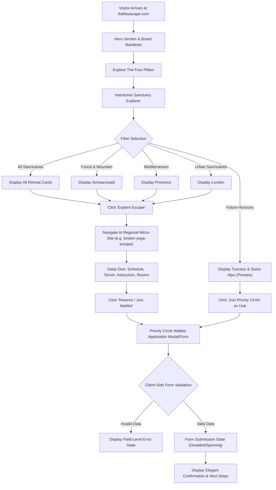

# 🗺️ Pillar 3: Application Flow & Interaction Design — The Flowscape

## 1. High-Level User Journey Diagram

---

## 2. Cross-Navigation Architecture

To maintain brand cohesion across multiple standalone retreat sites:
1. **Umbrella to Regional**: Every retreat card in `theflowscape/index.html` features an explicit CTA (`Explore Schwarzwald`, `Explore Provence`, `Explore London`) navigating directly to the respective micro-site.
2. **Regional to Umbrella**: Each regional micro-site contains a top brand link or banner acknowledging the parent collective:
   *`A Sanctuary of The Flowscape Retreat Collection ✦ View All Escapes`*
3. **Anchor Link Standards**: Internal page navigation uses smooth scroll anchors:
   - `#sanctuaries` — Sanctuary Explorer grid.
   - `#philosophy` — Four brand pillars.
   - `#experience` — Sample daily flow & itinerary.
   - `#waitlist` / `#inquire` — Primary conversion form.
   - `#faq` — Practical questions (travel, dietary, skill levels).

---

## 3. Mandatory UI State Machines

To ensure production-grade user experience, all interactive modules must implement four mandatory states:

### 1. The Priority Waitlist / Inquiry State Machine

| State | Visual & Behavioral Presentation | Accessibility / ARIA |
| :--- | :--- | :--- |
| **Default / Idle** | Clean inputs, subtle borders (`rgba(30,37,33,0.15)`), active CTA button with lotus hover state. | Labels linked via `for` and `id`. |
| **Focus / Active** | High-contrast focus ring (`2px solid #b42d32`), floating label / clear contrast. | Default browser outline enhanced. |
| **Loading / Submitting** | Button text transitions to *"Submitting Application..."*, button disabled, subtle pulsing lotus icon. | `aria-busy="true"`, button disabled. |
| **Success / Confirmed** | Form inputs replaced with luxury confirmation card: *"Welcome to the Priority Circle. Your sanctuary intake details have been recorded."* | `aria-live="polite"`, focus moved to heading. |
| **Validation Error** | Red accent line on invalid fields, localized microcopy below input (e.g. *"Please enter a valid email address"*). | `aria-invalid="true"`, `aria-describedby` error id. |
| **Network Error** | Graceful error banner: *"Connection interrupted. Please email us directly at concierge@theflowscape.com."* | `role="alert"`, `aria-live="assertive"`. |

### 2. Sanctuary Explorer Filter State Machine

| Filter State | Presentation | Fallback Behavior |
| :--- | :--- | :--- |
| **Active Selection** | Filter pill highlights in forest green (`#1e2521`) with white text and crimson dot. | Non-matching retreat cards fade out via CSS `opacity: 0` + `transform: translateY(12px)`. |
| **Empty State** | If a filter yields zero matches (e.g. unreleased seasons or custom search query): | Render empty state card: *"No retreats currently match this biome filter. Join the Priority Circle to request a new destination."* with CTA button. |
| **Transition Animation**| Fluid 250ms CSS easing transition on card grid (`ease-out`). | No sudden layout jumps; preserve container minimum height. |

---

## 4. Modal & Media Lightbox Flow
1. **Trigger**: Guest clicks on any sanctuary gallery photo or "View Gallery" button.
2. **Backdrop**: Smooth backdrop overlay (`rgba(15, 20, 18, 0.88)` with `backdrop-filter: blur(8px)`).
3. **Navigation**: Keyboard accessible (`Escape` to close, `ArrowLeft` / `ArrowRight` to cycle photos).
4. **Focus Trap**: Traps keyboard tab focus inside the modal until dismissed, returning focus to the trigger element upon exit.
