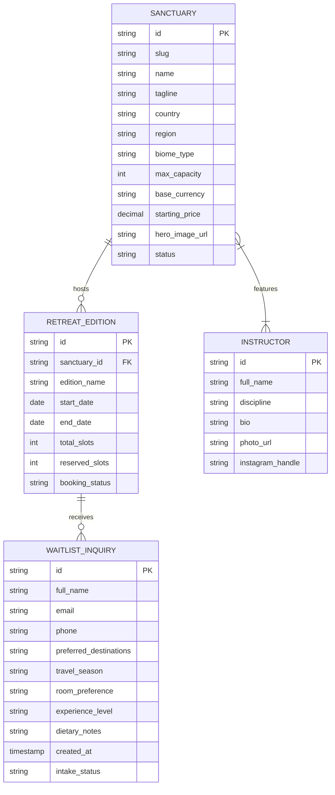

# 🗄️ Pillar 5: Data Schema, Payloads & Structured Data — The Flowscape

## 1. Domain Entities & Relational Data Model

Although currently rendered as a high-speed static architecture, The Flowscape maintains rigorous entity boundaries to ensure frictionless transition to dynamic headless backends (e.g. Supabase, SQLite, Strapi, or Airtable CRM).



---

## 2. Ingestion Payloads & Client Validation Schemas

### Priority Circle Waitlist Payload Specification

When a guest applies via the umbrella portal or regional waitlist modal, the front-end serializes the following JSON contract:

```typescript
// Zod / TypeScript Interface Contract
export interface WaitlistInquiryPayload {
  fullName: string;                // min: 2, max: 100 characters
  email: string;                   // RFC 5322 compliant email regex
  phone?: string;                  // Optional international format (E.164)
  destinations: Array<
    'schwarzwald' | 'provence' | 'london' | 'tuscany' | 'swiss-alps'
  >;                               // At least 1 destination selected
  preferredSeason: 'spring_2026' | 'summer_2026' | 'autumn_2026' | 'anytime';
  roomType: 'private_single' | 'shared_twin' | 'flexible';
  dietaryNotes?: string;           // Optional dietary needs (vegan, gluten-free, etc.)
  experienceLevel: 'beginner' | 'intermediate' | 'advanced' | 'all_levels';
  consentPrivacy: boolean;         // Must be true (GDPR requirement)
  submittedAt: string;             // ISO 8601 UTC timestamp
}
```

### JSON Schema Definition

```json
{
  "$schema": "http://json-schema.org/draft-07/schema#",
  "title": "FlowscapeWaitlistInquiry",
  "type": "object",
  "required": ["fullName", "email", "destinations", "preferredSeason", "consentPrivacy"],
  "properties": {
    "fullName": { "type": "string", "minLength": 2, "maxLength": 100 },
    "email": { "type": "string", "format": "email" },
    "phone": { "type": "string" },
    "destinations": {
      "type": "array",
      "items": { "type": "string" },
      "minItems": 1
    },
    "preferredSeason": {
      "type": "string",
      "enum": ["spring_2026", "summer_2026", "autumn_2026", "anytime"]
    },
    "roomType": {
      "type": "string",
      "enum": ["private_single", "shared_twin", "flexible"]
    },
    "consentPrivacy": { "type": "boolean", "const": true }
  }
}
```

---

## 3. Schema.org JSON-LD Structured Data

Every retreat page embeds verified Schema.org metadata to maximize organic discoverability on Google Search and rich knowledge graphs:

```json
{
  "@context": "https://schema.org",
  "@type": "LodgingBusiness",
  "name": "The Flowscape Retreats & Sanctuaries",
  "url": "https://theflowscape.com/",
  "logo": "https://theflowscape.com/favicon.svg",
  "image": "https://theflowscape.com/images/hero-flowscape.jpg",
  "description": "Curated collection of boutique yoga, meditation, and somatic wellness retreats across Europe and prime global destinations.",
  "hasOfferCatalog": {
    "@type": "OfferCatalog",
    "name": "Flowscape European Sanctuaries 2026",
    "itemListElement": [
      {
        "@type": "Offer",
        "itemOffered": {
          "@type": "Event",
          "name": "Schwarzwald Forest Flow Retreat",
          "startDate": "2026-05-14",
          "endDate": "2026-05-17",
          "location": {
            "@type": "Place",
            "name": "Schwarzwald Sanctuary",
            "address": {
              "@type": "PostalAddress",
              "addressRegion": "Baden-Württemberg",
              "addressCountry": "DE"
            }
          }
        }
      },
      {
        "@type": "Offer",
        "itemOffered": {
          "@type": "Event",
          "name": "Provence Sunlit Terroir Flow",
          "startDate": "2026-06-18",
          "endDate": "2026-06-21",
          "location": {
            "@type": "Place",
            "name": "Luberon Valley Bastide",
            "address": {
              "@type": "PostalAddress",
              "addressRegion": "Provence",
              "addressCountry": "FR"
            }
          }
        }
      },
      {
        "@type": "Offer",
        "itemOffered": {
          "@type": "Event",
          "name": "London Urban Sanctuary Flow",
          "startDate": "2026-07-09",
          "endDate": "2026-07-12",
          "location": {
            "@type": "Place",
            "name": "Richmond Glasshouse & Townhouse",
            "address": {
              "@type": "PostalAddress",
              "addressLocality": "London",
              "addressCountry": "GB"
            }
          }
        }
      }
    ]
  }
}
```
