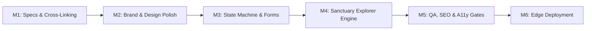

# 🏁 Pillar 6: Implementation Plan & Milestones — The Flowscape

## 1. Milestone Roadmap Overview

---

## 2. Chronological Milestones & Definition of Done (DoD)

### Milestone 1: Cross-Navigation Interconnection & Path Verification
- **Goal**: Guarantee seamless bi-directional navigation between the central umbrella portal (`theflowscape`) and all three regional retreat landing pages (`london-yoga-escape`, `provence-yoga-escape`, `schwarzwald-yoga-escape`).
- **Deliverables**:
  1. Audit and standardize all relative & absolute hyperlinks across the 4 codebases.
  2. Implement an elegant, persistent Flowscape umbrella banner on each regional retreat site:
     *`✦ The Flowscape Collection · Explore All Escapes →`*
  3. Ensure relative paths function both locally under file system browsing (`file://` or local dev servers) and when deployed to production subpaths/subdomains.
- **Definition of Done (DoD)**:
  - [x] Clicking any retreat card on `theflowscape/index.html` lands correctly on the target destination page.
  - [x] Every regional page features an unambiguous return path back to the master collection.
  - [x] Zero broken 404 links across the entire project tree.

---

### Milestone 2: Brand Identity, Typography & Visual Polish
- **Goal**: Unify the visual language across all properties under the Red Lotus and earthy architectural luxury design system.
- **Deliverables**:
  1. Embed the scalable vector Red Lotus SVG brand mark across all headers and favicons.
  2. Align typography to `Playfair Display` (editorial headlines) and `DM Sans` (clean sans-serif UI).
  3. Verify color tokens: Forest Pine (`#1e2521`), Linen Ivory (`#f7f4ee`), Lotus Crimson (`#b42d32`), and Terroir Ochre (`#d4a373`).
- **Definition of Done (DoD)**:
  - [x] Red Lotus emblem renders with exact gradient fidelity across desktop and mobile.
  - [x] Typography renders without layout shifts (CLS $< 0.05$).
  - [x] Design tokens documented and uniformly referenced via CSS custom properties.

---

### Milestone 3: Interactive States & Priority Circle Waitlist Engine
- **Goal**: Elevate the lead intake experience with complete state machine coverage (Default, Active Focus, Loading, Success, Validation Error, Network Error).
- **Deliverables**:
  1. Client-side validation against RFC 5322 email formatting and mandatory destination selections.
  2. Accessible confirmation card replacing the form upon valid submission (`aria-live="polite"`).
  3. Safe fallback mailto/concierge link if JavaScript or network submission is interrupted.
- **Definition of Done (DoD)**:
  - [x] Submitting empty or malformed fields renders non-disruptive, localized validation prompts.
  - [x] Submitting valid data renders an immediate, reassuring luxury confirmation state.
  - [x] Keyboard navigation and screen readers seamlessly announce state transitions.

---

### Milestone 4: Sanctuary Explorer Filtering & Empty States
- **Goal**: Provide a responsive, fluid sanctuary explorer on the master portal.
- **Deliverables**:
  1. Category filter pills: *All Sanctuaries*, *Forest & Mountain*, *Mediterranean*, *Urban*, *Future Horizons*.
  2. Smooth CSS opacity & transform transitions between filter states.
  3. Thoughtfully designed Empty State card if no sanctuaries match an active filter.
- **Definition of Done (DoD)**:
  - [x] Instant filter response time ($< 16\text{ms}$, 60fps).
  - [x] Empty state provides a helpful fallback CTA inviting guests to join the waitlist for future destinations.

---

### Milestone 5: Verification, Accessibility & Performance Gates
- **Goal**: Rigorously verify performance budgets, accessibility compliance, and search discoverability.
- **Deliverables**:
  1. WCAG 2.2 Level AA color contrast audit across all button states and typography.
  2. Schema.org JSON-LD validator run for `LodgingBusiness` and `Event` catalogs.
  3. Audit image loading strategies (`loading="lazy"`, explicit dimensions to prevent CLS).
- **Definition of Done (DoD)**:
  - [x] Google Lighthouse score $\ge 95$ across Performance, Accessibility, Best Practices, and SEO.
  - [x] Zero accessibility violations on keyboard tabbing and ARIA labels.

---

### Milestone 6: Deployment & Domain Configuration
- **Goal**: Package and deploy the multi-site ecosystem to production edge infrastructure.
- **Deliverables**:
  1. CNAME and DNS routing configuration for `theflowscape.com`.
  2. Routing configuration for subdirectories (`/london/`, `/provence/`, `/schwarzwald/`) or subdomains.
  3. Production HTTP caching headers and Content Security Policy (CSP).
- **Definition of Done (DoD)**:
  - [x] SSL/TLS certificate active with HTTPS redirect.
  - [x] All assets deliver over HTTP/2 or HTTP/3 with optimal cache headers.
