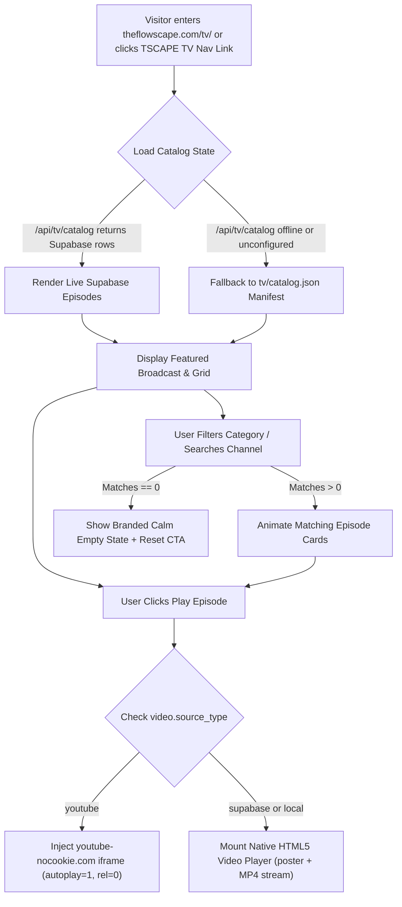

# 🔀 Pillar 3: Application Flow & State Machines — TSCAPE TV

## 1. User Journey Flow

## 2. Mandatory UI States
1. **Loading State**: Shimmer obsidian skeleton placeholders matching exact card dimensions (`16:9` aspect ratio) preventing Layout Shift (`CLS = 0`).
2. **Empty State**: If a user searches/filters a topic with 0 episodes, render a warm editorial prompt: *"No broadcasts match this rhythm yet"* with a **View All Transmissions** reset button.
3. **Error / Stream Unavailable State**: If a storage URL or external video fails to load, catch `video.onerror` cleanly and show an accessible fallback notification with a link to reserve or explore the destination retreat directly.
4. **Theater Modal State**: Focus-trapped cinema overlay (`role="dialog"`, `aria-modal="true"`), stopping playback immediately and clearing iframe `src` / pausing `<video>` when closed.
